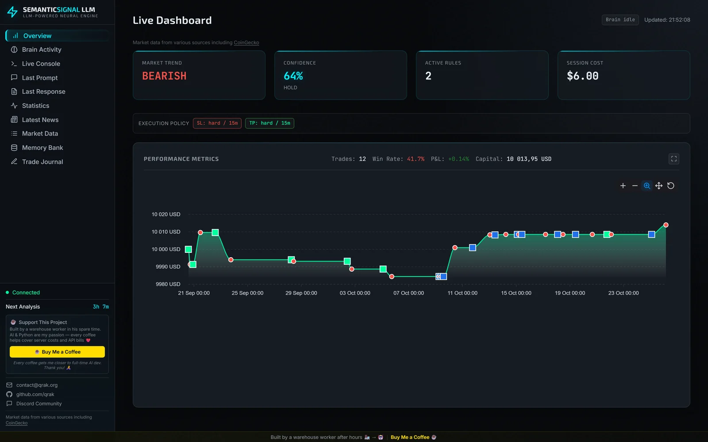
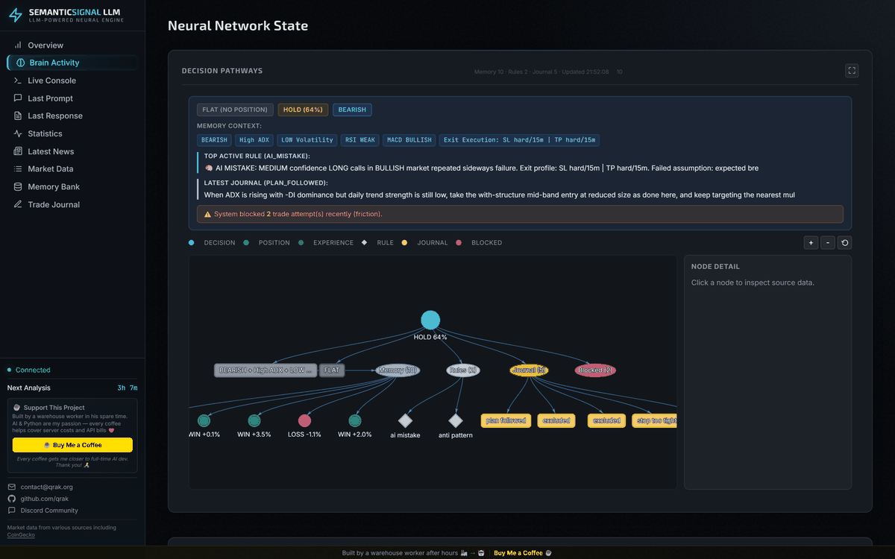
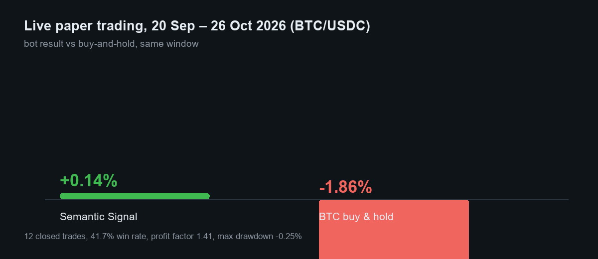
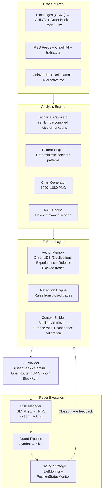

# Semantic Signal — an LLM trading agent that reads charts and remembers its closed trades

[](https://www.python.org)
[](tests)
[](LICENSE.md)

**Read this in:** [English](README.md) · [Polski](https://www.readme-i18n.com/qrak/LLM_trader?lang=pl) · [中文](https://www.readme-i18n.com/qrak/LLM_trader?lang=zh) · [日本語](https://www.readme-i18n.com/qrak/LLM_trader?lang=ja) · [한국어](https://www.readme-i18n.com/qrak/LLM_trader?lang=ko) · [Español](https://www.readme-i18n.com/qrak/LLM_trader?lang=es) · [Deutsch](https://www.readme-i18n.com/qrak/LLM_trader?lang=de) · [Português](https://www.readme-i18n.com/qrak/LLM_trader?lang=pt) · [Русский](https://www.readme-i18n.com/qrak/LLM_trader?lang=ru)



A single bot on BTC/USDC. Every four hours it renders the candles into a 1920×1080 chart, sends the
image together with 79 Numba-compiled indicators, the news context and its own closed-trade memory
to a multimodal model, and passes the answer through deterministic risk gates before booking a
paper trade.

Paper trading by default; no real funds are involved.

| | |
|---|---|
| Live dashboard | [semanticsignal.qrak.org](https://semanticsignal.qrak.org) |
| Showcase site | [qrak.org](https://qrak.org) — source: [qrak/semantic-signal-site](https://github.com/qrak/semantic-signal-site) |
| Result ledger | [the ledger below](#results) |
| Agent rules | [AGENTS.md](AGENTS.md) |



---

## Results

**Window:** 2026-09-20 → 2026-10-26 (36 days), BTC/USDC, 4h candles, 10 000 USDC simulated capital.
**Source:** the bot's own ledger (`data/trading/`), reproducible with `python scripts/results_report.py`.

| metric | bot | buy & hold |
|---|---|---|
| Return | **+0.14%** (+$13.95) | **−1.49%** |
| Closed trades | 12 | — |
| Win rate | 41.7% (5W / 5L) | — |
| Profit factor | 1.41 | — |
| Sharpe / Sortino | 0.19 / 0.36 | — |
| Max drawdown | −0.25% | — |
| Best / worst trade | +4.06% / −2.60% | — |
| Inference cost | $6.02 (8.1M in / 3.8M out tokens) | — |
| Net after inference | **+$7.93** | — |
| Analyses | 48 cycles, median 266 s, $0.0121 each | — |



Over those 36 days the bot returned +0.14% while the underlying fell 1.49%. That is ~1.6 percentage
points on twelve trades — not evidence of an edge. The paper book records zero fees, so the number is
gross of trading costs; at a 0.15% round trip the gain would be roughly erased. Two trades are
excluded from the statistics because their sandbox fills diverged from the real market. The numbers
above are the 2026-10-26 measurement; the inference cost and cycle totals move with every cycle the
bot runs. Method, per-trade table and the reproduction command: `python scripts/results_report.py`.

## Quick start

```bash
git clone https://github.com/qrak/LLM_trader.git && cd LLM_trader
python -m venv .venv && source .venv/bin/activate  # Windows: .venv\Scripts\Activate.ps1
pip install --no-compile -r requirements.txt -c constraints.txt
cp keys.env.example keys.env  # or export one provider key; `provider = local` needs none
python start.py               # dashboard at http://localhost:8000
```

Python **3.13** only, ~3 GB of disk, one API key (or a local LM Studio server). Platform launchers,
Windows quirks and the full secret table: [docs/SETUP.md](docs/SETUP.md).

## Features

| Feature | Notes |
|---|---|
| Brain with memory | ChromaDB stores closed-trade experiences, semantic rules and blocked trades. Each prompt carries the 3 nearest trades, win rate over the 20 nearest, 3 learned rules and up to 5 post-mortems, not the whole database. |
| Chart vision | A 1920×1080 candlestick PNG is sent with the numeric indicator stack, so the model can read pattern geometry from the image as well as from the numbers. |
| Reflection | Rules learned from closed trades carry a surprise ratio, `abs(realized − expected) / expected`, so outcomes driven by noise are discounted. |
| Claim validation | Model-reported trend strength is compared with the computed ADX, pattern quality is replaced by a deterministic scorer, and the EV framework is computed from the bot's own closed trades. |
| Risk pipeline | Guard chain, an R/R floor the brain can only raise, and dynamic SL/TP. With the executor live, the stop runs against the real market; the exchange leg is a backstop. |
| RAG news | RSS + Crawl4AI + CoinGecko/DeFiLlama/Alternative.me, relevance-scored locally and capped by the prompt budget. |
| Multi-provider | A configurable chain: `provider = all` walks Google → DeepSeek → LM Studio → OpenRouter → BlockRun (a chart goes Google → DeepSeek → OpenRouter → BlockRun), and a failed provider degrades to the next one inside the same cycle. This deployment runs `provider = deepseek`. |
| Tests | 2,689 collected tests (2,655 run outside the `integration` marker) covering LLM output corruption, async races, rate-limit backoff, closed-loop feedback and spot/futures wiring, with real temporary SQLite and ChromaDB. |

Long version, with the file that implements each of them: [docs/FEATURES.md](docs/FEATURES.md).

## Architecture



## Testing

```bash
python -m pytest tests -q          # 2,655 tests (2,689 collected), ~130 s
ruff check src scripts start.py    # clean
pyright src start.py               # 0 errors
```

Four areas — `domain_trading` (signals, orders, exits, risk, post-mortem), `domain_brain`
(vector memory, rules, scoring), `domain_rag_indicators` (news pipeline, indicator maths) and
`domain_infra` (providers, dashboard, persistence) — plus a Playwright check of the admin UI,
marked `integration` so CI skips it. Parametrisation multiplies the collected count, so it is
larger than the number of `def test_` functions. CI runs the same gates on every push:
`ruff`, `pyright`, `pytest -m "not integration"` and CodeQL. The showcase site is built and
deployed from its own repository.

## Documentation map

| File | Scope |
|---|---|
| [`AGENTS.md`](AGENTS.md) | Authority, architecture, config, code/security conventions, verification gates — plus one file per package (8 total) |
| [`docs/FEATURES.md`](docs/FEATURES.md) | Every feature in detail, with the implementing file |
| [`docs/SETUP.md`](docs/SETUP.md) | Requirements, platform scripts, secrets, dashboard deploy |
| [`docs/CONFIGURATION.md`](docs/CONFIGURATION.md) | Every config key, prompt budget, billing windows, executor handoff |
| [`CONTRIBUTING.md`](CONTRIBUTING.md) | Branches, releases, test gates, changelog rules |
| [`CHANGELOG.md`](CHANGELOG.md) | Every change, dated, with the run that verified it |

## Roadmap

- Live trading — delegated to a separate, private executor service (exchange testnet)
- Multiple trading-agent personalities — conservative, aggressive, contrarian, trend-following (aspirational)
- Multi-model consensus — a "council of models" for collective decision-making (aspirational)

## Disclaimer

Not financial advice. This software is experimental and in BETA; it trades a simulated book by
default and no real funds are involved. Profitability is unproven and paper results are not live
results. No warranty; use at your own risk.

## License

[MIT](LICENSE.md)
