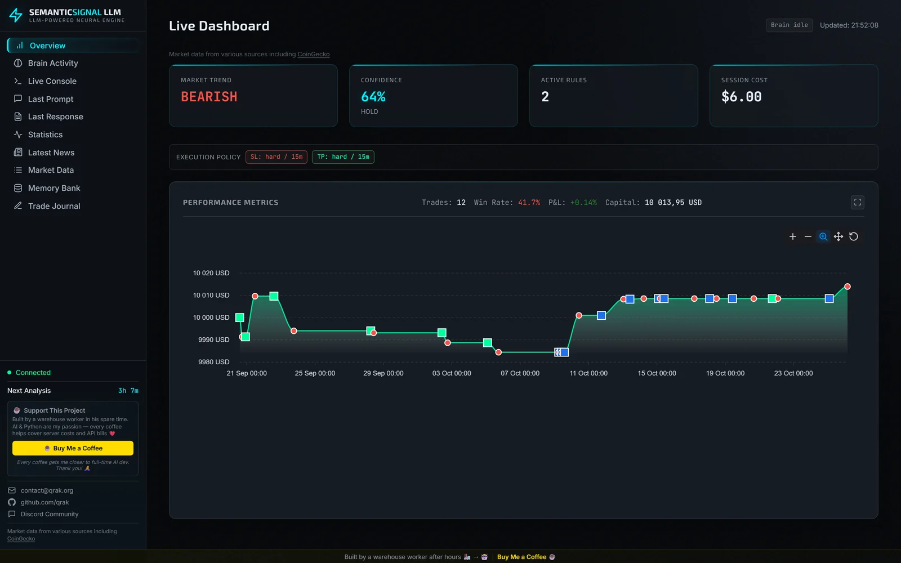
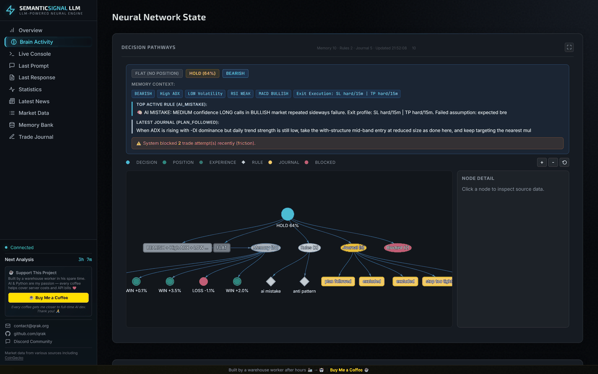
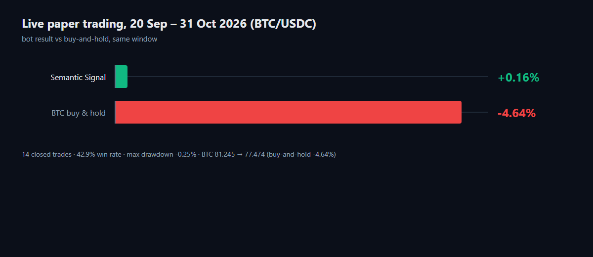
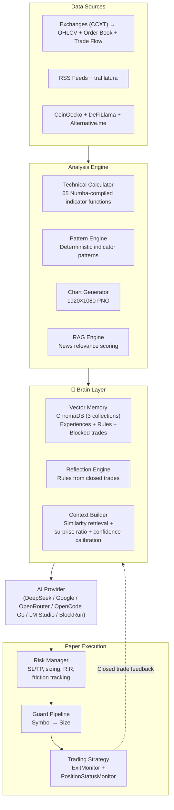

# Semantic Signal — an LLM trading agent that reads charts and keeps memory of its closed trades

[](https://www.python.org)
[](tests)
[](LICENSE.md)
[](https://github.com/qrak/LLM_trader/actions/workflows/tests.yml)
[](https://github.com/qrak/LLM_trader/actions/workflows/codeql.yml)

**Read this in:** [English](README.md) · [Polski](https://www.readme-i18n.com/qrak/LLM_trader?lang=pl) · [中文](https://www.readme-i18n.com/qrak/LLM_trader?lang=zh) · [日本語](https://www.readme-i18n.com/qrak/LLM_trader?lang=ja) · [한국어](https://www.readme-i18n.com/qrak/LLM_trader?lang=ko) · [Español](https://www.readme-i18n.com/qrak/LLM_trader?lang=es) · [Deutsch](https://www.readme-i18n.com/qrak/LLM_trader?lang=de) · [Português](https://www.readme-i18n.com/qrak/LLM_trader?lang=pt) · [Русский](https://www.readme-i18n.com/qrak/LLM_trader?lang=ru)



**Semantic Signal** is an experimental LLM trading agent that runs on paper. Once per closed candle it
renders a 1920×1080 chart, sends the image with 65 Numba-compiled indicators and its own closed-trade
memory to a multimodal model, then checks the answer with deterministic rules before a paper trade is
booked. The prompt, the retrieved memory and the decision are published for every cycle.

- **Live dashboard** — [semanticsignal.qrak.org](https://semanticsignal.qrak.org): the next cycle, the exact prompt, the raw response, the memory it pulled.
- **The ledger** — [qrak.org/results](https://qrak.org/results/): every closed trade since 2026-09-20, next to buy-and-hold.
- **How one cycle works** — [qrak.org/story](https://qrak.org/story/): the long version, with the file that implements each step.

Paper trading only; no real funds are involved. `crypto_pair` takes any CCXT market and `timeframe`
sets the candle. The public deployment runs BTC/USDC on 4h.

| | |
|---|---|
| Showcase site | [qrak.org](https://qrak.org) — source: [qrak/semantic-signal-site](https://github.com/qrak/semantic-signal-site) |
| Full feature list | [docs/FEATURES.md](docs/FEATURES.md) |
| Agent rules | [AGENTS.md](AGENTS.md) |



---

## Results

<!-- numbers:start -->
**Window:** 2026-09-20 → 2026-11-10 (52 days), BTC/USDC, 4h candles, 10 000 USDC simulated capital.
**Source:** the bot's own ledger, frozen at [`results/2026-11-12/`](results/2026-11-12); `python scripts/results_report.py --data-dir results/2026-11-12` reprints every number below.

| metric | bot | buy & hold |
|---|---|---|
| Return | **+0.05%** (+$5.27) | **-9.27%** |
| Closed trades | 16 (14 counted, 2 excluded for fill divergence) | — |
| Win rate | 37.5% (6W / 8L) | — |
| Profit factor | 1.11 | — |
| Sharpe / Sortino | 0.11 / 0.21 | — |
| Max drawdown | -0.25% | — |
| Best / worst trade | +4.06% / -2.60% | — |
| Inference cost | $7.12 (10.0M in / 4.8M out tokens) | — |
| Net after inference | -$1.84 | — |
| Analyses | 146 cycles, median 276 s, $0.0114 each | — |



Over those 52 days the bot returned +0.05% while the underlying fell 9.27%.
That is 9.3 percentage points on fourteen counted trades — not evidence of an edge.
The paper book records zero fees, so the number is gross of trading costs; at a 0.15% round trip the
result would be clearly negative. two trades are excluded from the statistics because
their sandbox fills diverged from the real market. The numbers above come from that frozen snapshot,
not from the live ledger, so they do not move with every cycle the bot runs.
Method, per-trade table and the reproduction command:
`python scripts/results_report.py --data-dir results/2026-11-12`.
<!-- numbers:end -->

## What this is not

- **Not profitable.** Fourteen counted trades are not a track record, and the paper book records zero fees.
- **Not live trading.** The executor runs against an exchange testnet; no real funds are involved anywhere.
- **Not a black box.** The prompt, the retrieved memories and the verdict behind every decision are on the dashboard.

## Quick start

```bash
git clone https://github.com/qrak/LLM_trader.git && cd LLM_trader
python -m venv .venv && source .venv/bin/activate  # Windows: .venv\Scripts\Activate.ps1
pip install --no-compile -r requirements.txt -c constraints.txt
cp config/config.ini.example config/config.ini  # tracked template; edit provider if needed
cp keys.env.example keys.env  # or export one provider key; `provider = local` needs none
python start.py               # dashboard at http://localhost:8000
```

Python **3.13** only, ~3 GB of disk, one API key (or a local LM Studio server). Platform launchers,
Windows quirks and the full secret table: [docs/SETUP.md](docs/SETUP.md).

While the bot runs, `http://localhost:8000/admin/` is the local settings desk: `config.ini`,
`keys.env` and the project documentation in one page. It is loopback-only, never displays a stored
secret, validates config changes with the loader, and needs a restart to apply. Details:
[docs/SETTINGS_PANEL.md](docs/SETTINGS_PANEL.md).

## Features

| Feature | Notes |
|---|---|
| Trade memory | ChromaDB (768-dimensional `bge-base-en-v1.5` embeddings) stores closed-trade experiences, semantic rules and rejected signals. Each prompt carries the 3 nearest past trades, win rate over the 20 nearest, up to 3 matching rules and up to 5 post-mortems, never the whole database. |
| Chart image | A 1920×1080 Plotly candlestick PNG (SMA, RSI, CMF, OBV panels and swing annotations) is sent with the numeric indicator stack. Chart export is the least reliable local step: it has a timeout and retries, and the cycle continues text-only if it fails. |
| Reflection | Every N closed trades (N follows the timeframe; 5 on 4h) the brain writes rules from its own outcomes. Each rule carries a surprise ratio, `|realized − expected| / expected`; a best-practice rule above 1.5 is annotated so the model can discount it. |
| Claim checks | Model-reported trend strength is compared with the computed ADX and overwritten when it disagrees. Pattern quality is scored deterministically. The EV rule in the prompt is computed from the bot's own closed trades. |
| Risk pipeline | Guard chain (symbol and position cap), a risk-reward gate (`min_rr_entry` is 0.0, so it is inert until a floor is configured or learned), and SL/TP sized from ATR. With the executor live, the stop is checked against the real market; the exchange leg is a backstop. |
| News and fundamentals | RSS feeds with full-article enrichment, CoinGecko, DeFiLlama and Alternative.me, relevance-scored locally and capped by the prompt budget. |
| Providers | `provider = all` builds a fallback chain (text: Google → DeepSeek → OpenCode Go → LM Studio → OpenRouter → BlockRun; charts skip LM Studio). A failed provider hands the cycle to the next one. This deployment runs `provider = deepseek`. |
| Settings desk | `http://localhost:8000/admin/` edits `config.ini` and `keys.env` from a form, shows the docs, and never returns a stored secret. Loopback only; config changes are validated with the loader and every save needs a restart. |
| MCP server | A read-only MCP server over the ledger: `recent` rows and `stats` counts per action, both opened with `mode=ro` and `PRAGMA query_only`, no write or order tool by design. It is an optional dependency and the bot never imports it. Details: [docs/MCP.md](docs/MCP.md). |
| Tests | 2,736 collected, all runnable. They cover malformed model output, async races, rate-limit backoff, the feedback loop and spot/futures wiring, using temporary SQLite and ChromaDB. |

Long version, with the file that implements each of them: [docs/FEATURES.md](docs/FEATURES.md).

## Architecture



## Testing

```bash
python -m pytest tests -q              # 2,736 tests, ~119 s
ruff check src scripts start.py        # clean
pyright src start.py                   # 0 errors
python scripts/check_dead_symbols.py   # 0 dead, 0 test-only
python scripts/check_comment_policy.py # 0 comments outside machine directives
```

Test directories: `domain_trading`, `domain_brain`, `domain_rag_indicators` and `domain_infra`.
The collected count is larger
than the number of `def test_` functions because of parametrisation. CI runs `ruff`, `pyright`,
`pytest -m "not integration"`, the dead-symbol and comment-policy gates, `check_claims.py` and CodeQL on
every push; a pull request labelled `refactor` also has a net-deletion budget. The showcase site is
built and deployed from its own repository.

## Documentation map

| File | Scope |
|---|---|
| [`docs/README.md`](docs/README.md) | Documentation index — the reader's entry point |
| [`docs/SETTINGS_PANEL.md`](docs/SETTINGS_PANEL.md) | Local settings desk: access, tabs, validation, restart, troubleshooting |
| [`docs/FEATURES.md`](docs/FEATURES.md) | Every feature in detail, with the implementing file |
| [`docs/SETUP.md`](docs/SETUP.md) | Requirements, platform scripts, secrets, dashboard deploy |
| [`docs/CONFIGURATION.md`](docs/CONFIGURATION.md) | Every config key, prompt budget, billing windows, executor handoff |
| [`docs/PUBLIC-NUMBERS.md`](docs/PUBLIC-NUMBERS.md) | The ledger → snapshot → `claims.json` → site chain, and the gate that keeps them equal |
| [`docs/MCP.md`](docs/MCP.md) | Read-only MCP server: the two tools, install, client config, why it cannot write |
| [`AGENTS.md`](AGENTS.md) | Instruction authority, architecture, config, conventions and verification gates, plus one `AGENTS.md` per package under `src/` |
| [`claims.json`](claims.json) | The numbers every public text quotes; `scripts/claims_report.py` regenerates it from the snapshot in [`results/`](results), `scripts/check_claims.py` fails on drift |
| [`CONTRIBUTING.md`](CONTRIBUTING.md) | Branches, releases, test gates, changelog rules |
| [`SECURITY.md`](SECURITY.md) | How to report a vulnerability privately, and which findings are not vulnerabilities here |
| [`CHANGELOG.md`](CHANGELOG.md) | Every change, dated, with the run that verified it |

## Not built yet

- **Live trading.** Order placement is a separate service that currently runs against an exchange testnet. Its code is not in this repository.
- **Several trading personalities** (conservative, contrarian, etc.). Not implemented.
- **Multi-model consensus.** Not implemented; the bot calls one provider per cycle, with fallbacks.

## Disclaimer

Not financial advice. This software is experimental and in BETA; it trades a simulated book by
default and no real funds are involved. Profitability is unproven and paper results are not live
results. No warranty; use at your own risk.

## License

[MIT](LICENSE.md)
