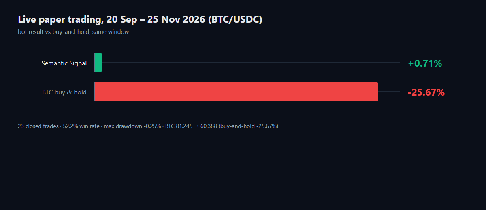

# Semantic Signal — an LLM trading agent that reads the market as text and keeps memory of its closed trades

[](https://www.python.org)
[](tests)
[](LICENSE.md)
[](https://github.com/qrak/LLM_trader/actions/workflows/tests.yml)
[](https://github.com/qrak/LLM_trader/actions/workflows/codeql.yml)

**Read this in:** **English** · [Polski](docs/i18n/README.pl.md) · [中文](docs/i18n/README.zh.md) · [日本語](docs/i18n/README.ja.md) · [한국어](docs/i18n/README.ko.md) · [Español](docs/i18n/README.es.md) · [Deutsch](docs/i18n/README.de.md) · [Português](docs/i18n/README.pt.md) · [Русский](docs/i18n/README.ru.md)


**Semantic Signal** is an experimental trading agent. On each closed candle it sends market indicators, news and closed-trade memory to a text model, then validates the answer with deterministic risk rules. Charts are for the dashboard and Discord, not model input. The public results below are simulated; optional order forwarding requires a separate executor.

[Live dashboard](https://semanticsignal.qrak.org) · [Trade ledger](https://qrak.org/results/) · [How a cycle works](https://qrak.org/story/) · [Documentation](docs/README.md)

## Results

<!-- numbers:start -->
**Window:** 2026-09-20 → 2026-11-25 (67 days), BTC/USDC, 4h candles, 10 000 USDC simulated capital.
**Source:** the bot's own ledger, frozen at [`results/2026-11-27/`](results/2026-11-27); `python scripts/results_report.py --data-dir results/2026-11-27` reprints every number below.

| metric | bot | buy & hold |
|---|---|---|
| Return (gross) | **+0.71%** (+$70.78) | **-25.67%** |
| Closed trades | 23 (23 counted) + 8 excluded (fill unverified or never executed) | — |
| Win rate | 52.2% (12W / 11L) | — |
| Profit factor | 1.91 | — |
| Sharpe / Sortino (per trade, not annualized) | 0.31 / 0.74 | — |
| Max drawdown | -0.25% | — |
| Best / worst trade | +6.29% / -2.67% | — |
| Inference cost | $7.77 (12.2M in / 5.3M out tokens) | — |
| Net after inference | +$63.01 | — |
| Analyses | 235 cycles, median 256 s, $0.0095 each | — |



Over those 67 days the bot returned +0.71% while the underlying fell 25.67%. That is
26.4 percentage points on 23 counted trades — not evidence of an edge.
The return does not deduct trading fees. The statistics exclude eight pairs whose fill could not
be verified against the real market or whose entry never executed. The numbers above come from that frozen snapshot,
not from the live ledger, so they do not move with every cycle the bot runs.
Method, per-trade table and the reproduction command:
`python scripts/results_report.py --data-dir results/2026-11-27`.
<!-- numbers:end -->

## Quick start

```bash
git clone https://github.com/qrak/LLM_trader.git && cd LLM_trader
python -m venv .venv && source .venv/bin/activate  # Windows: .venv\Scripts\Activate.ps1
pip install --no-compile -r requirements.txt -c constraints.txt
cp config/config.ini.example config/config.ini  # tracked template; edit provider if needed
cp keys.env.example keys.env  # or export one provider key; `provider = custom` on a local server needs none
python start.py               # dashboard at http://localhost:8000
```

Python **3.13** only, ~3 GB of disk, one API key (or any local OpenAI- or Anthropic-compatible server). Platform launchers,
Windows quirks and the full secret table: [docs/SETUP.md](docs/SETUP.md).

## Learn more

- [Features and implementation](docs/FEATURES.md) · [Configuration](docs/CONFIGURATION.md) · [Local settings panel](docs/SETTINGS_PANEL.md)
- [Contributing](CONTRIBUTING.md) · [Agent instructions](AGENTS.md) · [Security](SECURITY.md) · [Changelog](CHANGELOG.md)
```bash
python -m pytest tests -q  # 3,043 tests, ~50 s
```

## License

[MIT](LICENSE.md). Experimental software, not financial advice; paper results do not establish profitability.
