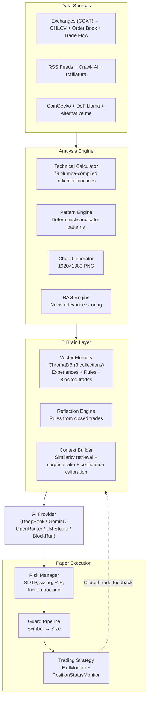

# Semantic Signal — an LLM trading agent that reads charts, remembers its closed trades, and argues with itself

[](https://www.python.org)
[](tests)
[](LICENSE.md)
[](https://github.com/qrak/LLM_trader)

**Read this in:** [English](README.md) · [Polski](https://www.readme-i18n.com/qrak/LLM_trader?lang=pl) · [中文](https://www.readme-i18n.com/qrak/LLM_trader?lang=zh) · [日本語](https://www.readme-i18n.com/qrak/LLM_trader?lang=ja) · [한국어](https://www.readme-i18n.com/qrak/LLM_trader?lang=ko) · [Español](https://www.readme-i18n.com/qrak/LLM_trader?lang=es) · [Deutsch](https://www.readme-i18n.com/qrak/LLM_trader?lang=de) · [Português](https://www.readme-i18n.com/qrak/LLM_trader?lang=pt) · [Русский](https://www.readme-i18n.com/qrak/LLM_trader?lang=ru)


One bot, one decision every four hours on BTC/USDC. It renders the candles into a **1920×1080
image**, sends that picture together with **79 Numba-compiled indicators**, the news context and
its own **closed-trade memory** to a multimodal LLM — then forces the answer through deterministic
zero-trust gates before anything is booked.

**Paper trading by default — no real funds are involved.** Profitability is unproven and stated as
such everywhere below.

| | |
|---|---|
| 🖥️ **Live dashboard** | [semanticsignal.qrak.org](https://semanticsignal.qrak.org) — watch the next cycle, the prompt, the raw response and the brain state |
| 🌐 **Showcase** | [qrak.org](https://qrak.org) — architecture, story, articles |
| 📊 **Results ledger** | [docs/RESULTS.md](docs/RESULTS.md) — every number on this page, reproducible |
| 🤖 **Agent rules** | [AGENTS.md](AGENTS.md) — 9 layered files, one per package |


---

## Results — live paper trading

**Window:** 2026-09-20 → 2026-10-26 (36 days), BTC/USDC, 4h candles, 10 000 USDC simulated capital.
**Source:** the bot's own ledger (`data/trading/`), reproducible with `python scripts/results_report.py`.

| metric | bot | buy & hold |
|---|---|---|
| Return | **+0.14%** (+$13.95) | **−1.83%** |
| Closed trades | 12 | — |
| Win rate | 41.7% (5W / 5L) | — |
| Profit factor | 1.41 | — |
| Sharpe / Sortino | 0.19 / 0.36 | — |
| Max drawdown | −0.25% | — |
| Best / worst trade | +4.06% / −2.60% | — |
| Inference cost | $6.00 (8.1M in / 3.8M out tokens) | — |
| Net after inference | **+$7.95** | — |
| Analyses | 48 cycles, median 266 s, $0.0121 each | — |


The honest reading: the bot beat the underlying by about two percentage points over five weeks,
which is **noise, not an edge**. Twelve trades cannot prove anything, fees are recorded as zero in
the paper book, and at a 0.15% round-trip fee the gain would roughly vanish. Two further trades are
excluded from statistics because sandbox fills printed below the real market. Full caveats and the
per-trade table: [docs/RESULTS.md](docs/RESULTS.md).

## How it compares

Different tools, different jobs — this table is a map, not a ranking.

| | **Semantic Signal** | [TradingAgents](https://github.com/TauricResearch/TradingAgents) | [Freqtrade](https://github.com/freqtrade/freqtrade) | [Hummingbot](https://github.com/hummingbot/hummingbot) |
|---|---|---|---|---|
| Shape | one bot, one decision per cycle | multi-agent research framework | strategy framework + backtesting | market making / arbitrage |
| LLM in the loop | every decision | yes — analyst, researcher, trader, risk agents | – | – |
| Reads chart images | yes, 1920×1080 | – | – | – |
| Learns from its own closed trades | yes — 768D memory + reflection with surprise ratio | yes — decision log + reflections | – (parameters are fixed) | – |
| Public live dashboard | [yes](https://semanticsignal.qrak.org) | – | self-hosted FreqUI | – |
| Runs on | crypto, paper book + testnet executor | stocks via Yahoo Finance | crypto, live exchange support | crypto, live exchange support |
| License | MIT | Apache-2.0 | GPL-3.0 | Apache-2.0 |

What TradingAgents has that this repo does not: a paper (arXiv 2412.20138), a research team and
116k stars. What this repo has that the others do not: chart images in the decision loop and a
public dashboard where you can read the actual prompt of the next cycle.

## Quick start

```bash
git clone https://github.com/qrak/LLM_trader.git && cd LLM_trader
python -m venv .venv && source .venv/bin/activate  # Windows: .venv\Scripts\Activate.ps1
pip install -r requirements.txt -c constraints.txt
cp keys.env.example keys.env  # or export one provider key; `provider = local` needs none
python start.py               # dashboard at http://localhost:8000
```

Python **3.13** only, ~3 GB of disk, one API key (or a local LM Studio server). Platform launchers,
Windows quirks and the full secret table: [docs/SETUP.md](docs/SETUP.md).

## Features

| | Feature | What makes it different |
|---|---|---|
| 🧠 | **Brain with memory** | ChromaDB keeps closed-trade experiences, semantic rules and blocked trades; each prompt carries the 3 nearest trades, win rate over the 20 nearest, 3 learned rules and up to 5 post-mortems — not the whole database |
| 👁️ | **Chart vision** | A real 1920×1080 candlestick PNG next to the numeric stack, not a text summary of an indicator |
| 🔁 | **Reflection with surprise ratio** | Rules learned from winning trades are tagged by `abs(realized − expected) / expected`, so luck is discounted instead of copied |
| ✅ | **Claim validation** | The model's "strong trend" claim is compared with the actual ADX; pattern quality is replaced by a deterministic scorer; the EV framework is computed from the bot's own closed trades |
| 🛡️ | **Risk pipeline** | Guard chain, R/R floor the brain can only raise, dynamic SL/TP; when the executor is live the stop runs against the real market, the exchange leg is only a backstop |
| 📰 | **RAG news** | RSS + Crawl4AI + CoinGecko/DeFiLlama/Alternative.me, relevance-scored locally, capped by the prompt budget |
| 🔀 | **Multi-provider** | DeepSeek primary with Google, OpenRouter, LM Studio and BlockRun as fallbacks; a dead provider degrades to the next one inside the same cycle |
| 🧪 | **2,514 tests** | LLM output corruption, async races, rate-limit backoff, closed-loop feedback, spot/futures wiring — with real temporary SQLite and ChromaDB |

Long version, with the files that implement each of them: [docs/FEATURES.md](docs/FEATURES.md).

## Architecture



## Testing

```bash
python -m pytest tests -q          # 2,514 tests, ~145 s
ruff check src scripts start.py    # clean
pyright src start.py               # 0 errors
```

Four areas — `domain_trading` (signals, orders, exits, risk, post-mortem), `domain_brain`
(vector memory, rules, scoring), `domain_rag_indicators` (news pipeline, indicator maths) and
`domain_infra` (providers, dashboard, persistence) — plus a Playwright check of the admin UI,
marked `integration` so CI skips it. Parametrisation multiplies the collected count, so it is
larger than the number of `def test_` functions. CI runs the same gates on every push:
`ruff`, `pyright`, `pytest -m "not integration"`, the website build and CodeQL.

## Documentation map

| File | Scope |
|---|---|
| [`AGENTS.md`](AGENTS.md) | Authority, architecture, config, code/security conventions, verification gates — plus one file per package (8 total) |
| [`docs/FEATURES.md`](docs/FEATURES.md) | Every feature in detail, with the implementing file |
| [`docs/SETUP.md`](docs/SETUP.md) | Requirements, platform scripts, secrets, dashboard deploy |
| [`docs/CONFIGURATION.md`](docs/CONFIGURATION.md) | Every config key, prompt budget, billing windows, executor handoff |
| [`docs/RESULTS.md`](docs/RESULTS.md) | The ledger, the benchmark, the caveats, the reproduction command |
| [`CONTRIBUTING.md`](CONTRIBUTING.md) | Branches, releases, test gates, changelog rules |
| [`CHANGELOG.md`](CHANGELOG.md) | Every change, dated, with the run that verified it |

## News

- **2026-10-26** — CI now enforces what the repository already claimed: `pyright` is a gate, the
  website is built on every push, a pull request is dependency-reviewed, and `master` requires four
  green checks.
- **2026-10-26** — releases stop being a second hand-written history: every green `master` build
  gets an immutable `build-YYYY.MM.DD-HHMM` tag and one rolling "Latest build" entry.
- **2026-10-26** — inference cost enters the cycle journal and the EV threshold: the prompt's
  break-even now includes the measured cost of the analyses it competes with.

Older entries live in [CHANGELOG.md](CHANGELOG.md) and [docs/changelog-archive-2026.md](docs/changelog-archive-2026.md).

## Roadmap

- 🔄 **Live trading** — delegated to a separate, private executor service (exchange testnet)
- ⏳ **Multiple trading-agent personalities** — conservative, aggressive, contrarian, trend-following *(aspirational)*
- ⏳ **Multi-model consensus** — a "council of models" for collective decision-making *(aspirational)*

## Disclaimer

**NOT FINANCIAL ADVICE.** This software is experimental and in BETA. It trades a simulated book by
default and no real funds are involved. Profitability is unproven, paper results are not live
results, and exchange reconciliation is the least-tested part of the live path. No warranty
provided. Use at your own risk.

## License

[MIT](LICENSE.md)
