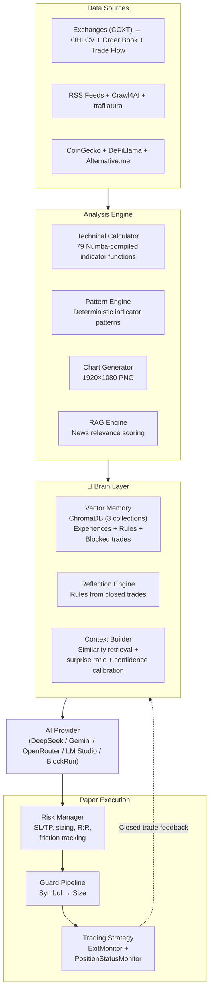

# 🤖 SEMANTIC SIGNAL LLM (LLM Trader)

*An autonomous paper-trading agent that reads charts, remembers outcomes and sharpens its strategy from its own closed trades.*

[](https://www.python.org)
[](LICENSE.md)
[](https://github.com/qrak/LLM_trader)

🌐 **[Public Landing Page](https://semanticsignal.qrak.org/landing.html)** — interactive architecture overview & system showcase
📊 **[Live Dashboard](https://semanticsignal.qrak.org)** — watch the trading brain think
📖 **[Interactive Web Story](https://semanticsignal.qrak.org/story)**
💬 **[Join the Discord](https://discord.gg/ZC48aTTqR2)**

---

> 💡 **Paper trading by default — no real funds are involved.** A decision may be forwarded to a separate, private executor service. Profitability is unproven; see the [Disclaimer](#disclaimer).

---

## Quick Start

```bash
git clone https://github.com/qrak/LLM_trader.git && cd LLM_trader
python -m venv .venv && source .venv/bin/activate  # or .venv\Scripts\Activate.ps1 on Windows
pip install -r requirements.txt -c constraints.txt
cp keys.env.example keys.env  # optional; alternatively set your selected provider key in the OS environment
python start.py               # dashboard at http://localhost:8000
```

`constraints.txt` carries the version floors and compatibility caps for packages that only arrive as dependencies; always install with `-c constraints.txt` (see [CONTRIBUTING.md](CONTRIBUTING.md)).

<details>
<summary>Detailed setup for Windows, Linux, macOS →</summary>

**Platform-specific scripts** live in `scripts/`:

| Script | Purpose |
|--------|---------|
| `scripts/start_script_main.ps1` | Start the bot (Windows) |
| `scripts/start_script_main_linux.sh` | Start the bot (Linux) |
| `scripts/start_script_main_macos.sh` | Start the bot (macOS) |
| `scripts/run_all_tests.sh` | Run the full test suite in `.venv` |
| `scripts/query_trade_history.py` | CLI utility to inspect the SQLite trade history |

Each launcher checks `requirements.txt` and `constraints.txt` against the installed environment and only runs pip when something is actually unmet.
</details>

### Runtime Controls

| Key | Action |
|-----|--------|
| `a` | Force analysis — run an immediate market check |
| `d` | Toggle the dashboard on/off |
| `h` | Help — show available commands |
| `q` | Quit — graceful shutdown with state preservation |
| `Shift+R` | In-place reload (relaunches `start.py` through the launcher) |

---

## System Requirements

| Component | Minimum | Recommended |
|-----------|---------|-------------|
| **Python** | 3.13 | 3.13+ |
| **RAM** | 4 GB | 8+ GB |
| **Disk** | 3 GB | 8+ GB (a full environment measures ≈2.3 GB, plus browser binaries for news enrichment, logs and trade data) |
| **CPU** | 2 cores | 4+ cores |
| **GPU** | Not required | Not required — embeddings run on CPU |
| **OS** | Windows 10+, Linux, macOS | Linux (WSL2) |
| **Internet** | Required (API calls) | Required |

---

## Features

- **🧠 Brain with Memory** — ChromaDB stores closed-trade experiences, semantic rules and blocked-trade friction. Before each decision the bot retrieves the **3 nearest past trades**, win-rate and average-P&L statistics over the **20 nearest trades**, the **3 most relevant learned rules** and up to **5 recent post-mortem lessons** — not the whole database — and injects them into the prompt. Closed trades are embedded locally with `BAAI/bge-base-en-v1.5` (768 dimensions).

  The historical MAE reference is the largest observed drawdown of at least five winning trades with valid drawdown metadata; its sample count travels with it. It is not a guaranteed safe limit, not an automatic SL floor and not a reason to widen a stop. Missing or invalid observations never count as a zero drawdown.

  Prompt size is bounded by `[prompt_budget]`: 100,000 estimated tokens per request, a 50,000-token brain context, a 10% model-window safety margin and a 16,384-token image reserve, counted with the shared `TokenCounter` (`cl100k_base` estimates). Oversized contexts drop whole lower-priority blocks while keeping the current position, risk instructions, response format and recent lessons; if protected material still cannot fit, no request is sent.

- **📈 Vision AI Chart Analysis** — Generates a **1920×1080 PNG** candlestick chart with indicators and sends it to a multimodal model for visual pattern recognition. The chart is one input next to the numeric indicator stack, not a replacement for it.

- **🔄 Reflection Engine** — After every *N* closed trades the system synthesises best-practice, anti-pattern and corrective rules annotated with a **surprise ratio**, so the model can discount lucky or unlucky outcomes. Rules persist in vector memory.

- **✅ Claim Validation** — Model claims are cross-checked against computed indicators: reported trend strength is compared with the actual ADX, and pattern quality is replaced by a deterministic scorer. An **expected-value framework** — fees, the position cap and expectancy read from the bot's own closed trades — is injected into every prompt as a decision rule, and the entry gate enforces the stricter of the configured R/R floor and the brain's learned threshold.

- **📰 RAG News Engine** — Free RSS feeds (CoinDesk, CoinTelegraph, Decrypt, CryptoSlate) parsed with `feedparser`/`defusedxml`, optionally enriched through Crawl4AI with trafilatura text extraction, plus market data from CoinGecko, DeFiLlama and Alternative.me.

- **📊 Live Dashboard** — FastAPI + WebSocket SPA on `0.0.0.0:8000` (or [semanticsignal.qrak.org](https://semanticsignal.qrak.org)) with ten tabs: Overview, Brain, Console, Prompt, Response, Stats, News, Market, Memory and Journal.

- **🛡️ Risk Pipeline** — Pre-execution guard pipeline (`src/trading/guards/`: configured symbol, position-size cap), an entry R/R floor resolved by `src/trading/rr_policy.py` (the stricter of `min_rr_entry` and the brain's learned threshold) and dynamic SL/TP scaling. `min_rr_entry = 0.0` starts without a fixed R/R floor; the brain can raise it after enough losing low-R/R trades. Soft exits at candle close, hard exits polled at a configurable interval against the live ticker.

- **🔀 Multi-Provider AI Routing** — Primary: DeepSeek official API (`deepseek-flash`, accepts charts natively). Configurable fallback chain across Google Gemini, OpenRouter, a local LM Studio server and BlockRun; every provider that supports images gets the chart.

- **🧪 Regression Tests** — 2,419 collected tests on the current revision, covering LLM output corruption, async races, rate-limit backoff, closed-loop feedback and spot/futures wiring. Real temporary SQLite and ChromaDB databases are exercised, without live model or exchange calls.

- **🗂️ Layered Agent Documentation** — Root [`AGENTS.md`](AGENTS.md) plus a per-package `AGENTS.md` for each area, so a coding model reads one package instead of the whole manual.

---

## Architecture



### Key Files

| Path | Role |
|------|------|
| `start.py` | Entry point — 9-stage dependency provisioning, ChromaDB, CoinGecko cache, journal rotation |
| `src/app.py` | Main async loop, ticker fetch, analysis orchestration, unconfirmed-command alerts |
| `src/trading/brain.py` | `TradingBrainService` — context assembly, experience recording, reflection triggers |
| `src/trading/vector_memory.py` | ChromaDB interface — trade experiences, semantic rules, blocked trades, embedding cache |
| `src/trading/vector_memory_rules.py` | `VectorMemoryRulesMixin` — rule lifecycle: decay scoring, evidence ranking, surprise ratio |
| `src/trading/executor_handler.py` | Forwards decisions to the executor over HTTP, JSON file fallback, dead-letter queue |
| `src/trading/executor_reconciliation.py` | Compares bot state with the executor's, resolves positions and late receipts |
| `src/analyzer/analysis_engine.py` | Market analysis orchestration — indicators, chart, RAG, LLM call |
| `src/managers/provider_orchestrator.py` | AI provider fallback chain with retry logic and cost tracking |
| `src/managers/risk_manager.py` | Dynamic SL/TP, position sizing, friction tracking |
| `src/managers/post_mortem_repository.py` | Stores model-written post-mortems; the brain includes up to five recent ones |
| `src/trading/trading_strategy.py` | Position lifecycle, guard enforcement, exit monitoring |
| `src/analyzer/prompts/template_manager.py` | System prompt construction with a falsification-based invalidation step |
| `src/analyzer/trend_validator.py` | Cross-checks model-reported trend strength against the computed ADX |
| `src/analyzer/pattern_quality_scorer.py` | Deterministic pattern quality scoring replacing the model's self-reported score |
| `src/notifiers/notifier.py` | Discord notifications with message-expiration tracking |

---

## Testing

```bash
# Full suite — 2,419 collected tests (measured on the current revision)
pytest tests/ -q

# Focused areas
pytest tests/domain_trading -q          # position lifecycle, guards, risk, post-mortem
pytest tests/domain_brain -q            # vector memory, rules, learning, prompt templates
pytest tests/domain_rag_indicators -q   # RAG/news pipeline and indicator maths
pytest tests/domain_infra -q            # providers, dashboard, persistence, plumbing

# Lint (passes on src/, scripts/ and start.py)
ruff check src scripts start.py
```

| Test area | Files | `def test_` functions | Notes |
|-----------|-------|----------------------|-------|
| `tests/domain_trading` | 9 | 317 | Signals, orders, exits, risk, post-mortem |
| `tests/domain_brain` | 12 | 271 | ChromaDB operations, rules, scoring, embedding cache |
| `tests/domain_rag_indicators` | 9 | 274 | RSS/Crawl4AI, news database, indicator maths |
| `tests/domain_infra` | 17 | 359 | Provider fallback, dashboard routes, persistence |
| `tests/test_admin_playwright.py` | 1 | 35 | Playwright/browser checks; skipped unless a dashboard is running |

Parametrisation multiplies the function counts, so the collected total is larger than the sum of `def test_`.

---

## Configuration

Key settings in `config/config.ini`:

| Setting | Default | Description |
|---------|---------|-------------|
| `crypto_pair` | BTC/USDC | Trading pair |
| `timeframe` | 4h | Analysis candle timeframe (4h or higher; smaller frames degrade signal quality) |
| `model_verbosity` | full | New-analysis detail: low (~400), medium (~1000), high (~2000), full (~8000 narrative output tokens) |
| `provider` | deepseek | AI provider (`local`, `googleai`, `openrouter`, `deepseek`, `all`; BlockRun is a fallback-chain member only) |
| `demo_quote_capital` | 10000 | Simulated capital (USDC) |
| `max_position_size` | 0.10 | Max position as a fraction of capital |
| `min_rr_entry` | 0.0 | Baseline R/R floor for the entry gate (0 = no fixed floor; the brain can raise it) |
| `stop_loss_type` | hard | `hard` (interval polling) or `soft` (candle close) |
| `stop_loss_check_interval` | 15m | Hard-exit polling interval; must not exceed the timeframe |
| `reference_exit_check_seconds` | 10 | How often the SL/TP is checked against the REAL market while a position is open and the executor is live (`0` = off). This is the stop that runs; the exchange leg is only a catastrophe backstop |

`[model_config] model_verbosity` controls the **new answer**, not how much history is carried
forward. `full` requests a complete Markdown research report: metrics, timeframe comparison,
indicator categories and interpretations, key levels, news impact, chart evidence, educational
context, scenarios, risks and synthesis. Other modes retain their compact 3/5/13-line formats.
The token figures are narrative writing targets, excluding decision JSON and hidden reasoning —
not hard API limits. `max_tokens` / provider-specific output caps still apply; no post-generation
truncation or extra formatting call is used. Previous reasoning has **no separate length cap**;
the structured decision thesis is preferred when available, otherwise the sanitized narrative is
kept without length-based truncation. `[prompt_budget] request_max_tokens` (default **100000
estimated input tokens**) protects the whole request. Before each provider/model call, including
fallbacks, the guard also reserves output capacity, an image allowance and a safety margin within
the configured model context window. Under pressure it omits lower-priority sections rather than
cutting arbitrary tokens; if protected content still cannot fit, no request is sent. Prior Python
R/R feedback remains protected. Response-schema/R/R checks validate decisions, not prompt length.

Local token budgets use `tiktoken`'s `cl100k_base` as an **estimate**, not a Gemini/DeepSeek-native
counter. Upgrading tiktoken does not supply those tokenizers or pricing. Recorded request usage
comes from the provider API (including Google thinking tokens); OpenRouter cost comes from its
generation endpoint when available. Google/DeepSeek dollar figures are rate-table estimates,
not invoice reconciliation; the current calculation does not apply cache-hit discounts.

Secrets come from **OS / service environment variables (recommended)** or an optional `keys.env` in the repository root; process variables take precedence, including explicitly empty values. Both sources are read at startup, so restart after changes (on Windows, reopen the launcher terminal after editing persistent variables). Environment variables are not encrypted — keep them out of logs and shell history. `keys.env.example` lists every variable.

Only the selected provider needs its key. OpenRouter-hosted Google or DeepSeek models use **only `OPENROUTER_API_KEY`**, not the direct-vendor keys. With `provider = all`, unavailable clients are skipped; `provider = local` needs no cloud key.

| Variable | Required | For |
|----------|----------|-----|
| `GOOGLE_STUDIO_API_KEY` | Only for `googleai` | Google AI Studio provider |
| `GOOGLE_STUDIO_PAID_API_KEY` | If used | Paid-tier Google AI |
| `OPENROUTER_API_KEY` | Only for `openrouter` | Every model served through OpenRouter |
| `DEEPSEEK_API_KEY` | Only for `deepseek` | DeepSeek official API |
| `BOT_TOKEN_DISCORD` | If used | Discord notifications |
| `MAIN_CHANNEL_ID` | If used | Discord notification channel |
| `COINGECKO_API_KEY` | No | Market metrics (rate-limit boost) |
| `HF_TOKEN` | No | HuggingFace model download |

### Billing windows (`config/peak_rates.json`)

Some providers charge different rates at different hours — DeepSeek is half price off-peak (Mon–Fri 01:00–04:00 and 06:00–10:00 UTC are peak; nights and the whole weekend are off-peak). The bot applies that window when reporting cost, so the log shows the price actually charged: `Request cost: $0.007000 (off-peak x0.5)`.

Per-token rates live in `config/model_pricing.json` and are treated as the **base (peak)** rates; `peak_rates.json` only declares *when* a window applies and how it scales those rates. The file is optional — copy `config/peak_rates.example.json` to `config/peak_rates.json`; without it the defaults from `src/utils/peak_rates.py` apply and anything unlisted is billed flat. It is read at startup, and each provider entry is merged over its built-in default, so list only what you change:

```json
{
  "deepseek": {
    "models": ["deepseek-flash", "deepseek-v4-flash-vision-exp", "deepseek-v4-pro"],
    "peak_multiplier": 1.0,
    "off_peak_multiplier": 0.25,
    "peak_windows_utc": [
      {"days": ["mon-fri"], "start_utc": "01:00", "end_utc": "04:00"}
    ]
  }
}
```

| Field | Meaning |
|-------|---------|
| `models` | Models the entry covers (omitted = every model of that provider) |
| `peak_multiplier` / `off_peak_multiplier` | Scale applied to the base rates inside / outside the peak windows |
| `peak_windows_utc` | Peak windows. `days` takes single names or inclusive ranges (`["mon-fri"]`, `["sat","sun"]`); clock values are UTC, start-inclusive and end-exclusive |
| `_default` | Entry used for providers and models nobody listed (multiplier `1.0` = flat rates) |

---

## Agent Documentation Map

Contributors (human or model) get the rules in layers, so nobody has to read the whole manual:

| File | Scope |
|------|-------|
| [`AGENTS.md`](AGENTS.md) | Authority, system overview, data flow, config, operational rules, code/security conventions, verification gates, map |
| [`src/AGENTS.md`](src/AGENTS.md) | Cross-package regression contracts (`parsing/`, `utils/`, `notifiers/`, `rag/`, `dashboard/`) |
| [`src/trading/AGENTS.md`](src/trading/AGENTS.md) | Trading brain, strategy, position management, monitors, notifiers |
| [`src/trading/guards/AGENTS.md`](src/trading/guards/AGENTS.md) | Pre-execution guard pipeline |
| [`src/analyzer/AGENTS.md`](src/analyzer/AGENTS.md) | Analysis engine, prompt templates, chart vision |
| [`src/indicators/AGENTS.md`](src/indicators/AGENTS.md) | Indicator computation and caching |
| [`src/managers/AGENTS.md`](src/managers/AGENTS.md) | Persistence, SQLite history, exchange adapters |
| [`src/rag/AGENTS.md`](src/rag/AGENTS.md) | Vector memory, Crawl4AI news ingestion, market components |
| [`src/dashboard/AGENTS.md`](src/dashboard/AGENTS.md) | FastAPI dashboard, auth, UI and accessibility conventions |

Each file links back to the root; the root never duplicates package detail.

---

## Roadmap

- 🔄 **Live trading** — delegated to a separate, private executor service (exchange testnet)
- ⏳ **Multiple trading-agent personalities** — conservative, aggressive, contrarian, trend-following *(aspirational)*
- ⏳ **Multi-model consensus** — a "council of models" for collective decision-making *(aspirational)*

---

## Disclaimer

**NOT FINANCIAL ADVICE.** This software is experimental and in BETA. It trades a simulated book by default and no real funds are involved. Profitability is unproven, paper results are not live results, and exchange reconciliation is the least-tested part of the live path. No warranty provided. Use at your own risk.

## License

[MIT](LICENSE.md)
