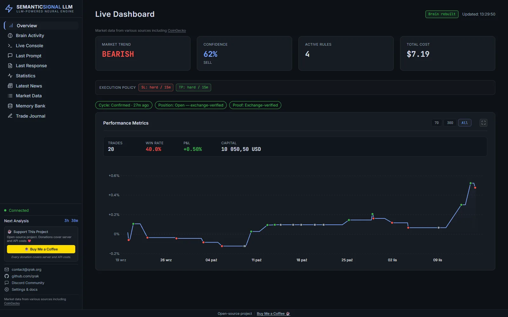

# Semantic Signal — 市場をテキストとして読み、決済済み取引を記憶する LLM トレーディングエージェント

[](https://www.python.org)
[](../../tests)
[](../../LICENSE.md)
[](https://github.com/qrak/LLM_trader/actions/workflows/tests.yml)
[](https://github.com/qrak/LLM_trader/actions/workflows/codeql.yml)

**他の言語で読む:** [English](../../README.md) · [Polski](README.pl.md) · [中文](README.zh.md) · **日本語** · [한국어](README.ko.md) · [Español](README.es.md) · [Deutsch](README.de.md) · [Português](README.pt.md) · [Русский](README.ru.md)



**Semantic Signal** は実験的なトレーディングエージェントです。確定した足が閉じるたびに、市場指標・ニュース・決済済み取引の記憶をテキストモデルへ送り、その回答を決定論的なリスクルールで検証します。チャートはダッシュボードと Discord のためのもので、モデルの入力ではありません。以下の公開結果はすべてシミュレーションです。任意で有効にする注文転送には、別途エグゼキュータが必要です。

[ライブダッシュボード](https://semanticsignal.qrak.org) · [取引台帳](https://qrak.org/results/) · [1 サイクルの流れ](https://qrak.org/story/) · [ドキュメント](../README.md)

## 結果

**対象期間：** 2026-09-20 → 2026-11-25（67 日間）、BTC/USDC、4 時間足、シミュレーション資本 10 000 USDC。
**出典：** ボット自身の台帳を [`results/2026-11-25/`](../../results/2026-11-25) で凍結したもの。`python scripts/results_report.py --data-dir results/2026-11-25` で以下のすべての数値を再出力できます。

| 指標 | ボット | バイ・アンド・ホールド |
|---|---|---|
| リターン（グロス） | **+0.71%**（+$70.78） | **-27.91%** |
| 決済済み取引 | 23（有効 23 件）+ 除外 8 件（約定が未検証、または未執行） | — |
| 勝率 | 52.2%（12 勝 / 11 敗） | — |
| プロフィットファクター | 1.91 | — |
| シャープ / ソルティノ（取引単位、年率換算なし） | 0.31 / 0.74 | — |
| 最大ドローダウン | -0.25% | — |
| 最良 / 最悪の取引 | +6.29% / -2.67% | — |
| 推論コスト | $7.64（入力 11.8M / 出力 5.2M トークン） | — |
| 推論コスト控除後の純額 | +$63.14 | — |
| 分析回数 | 224 サイクル、中央値 259 秒、1 回 $0.0093 | — |


この 67 日間でボットのリターンは +0.71%、一方で原資産は 27.91% 下落しました。これは
有効な 23 取引での 28.6 ポイントであり、優位性の証拠にはなりません。
リターンは取引手数料を控除していません。統計では、約定を実際の市場で検証できなかった、
またはエントリーが執行されなかった 8 組を除外しています。上記の数値はその凍結スナップショットに由来し、
ライブ台帳ではないため、ボットがサイクルを回すたびに変動することはありません。
手法・取引ごとの表・再現コマンド：
`python scripts/results_report.py --data-dir results/2026-11-25`。

> この翻訳版は凍結されたスナップショットです。最新の公式数値は [English README](../../README.md) を参照してください。

## クイックスタート

```bash
git clone https://github.com/qrak/LLM_trader.git && cd LLM_trader
python -m venv .venv && source .venv/bin/activate  # Windows の場合： .venv\Scripts\Activate.ps1
pip install --no-compile -r requirements.txt -c constraints.txt
cp config/config.ini.example config/config.ini  # 追跡対象のテンプレート。必要なら provider を編集
cp keys.env.example keys.env  # または provider のキーを 1 つ export。ローカルサーバーなら `provider = custom` でキー不要
python start.py               # ダッシュボードは http://localhost:8000
```

Python **3.13** のみ、ディスク約 3 GB、API キー 1 つ（または OpenAI か Anthropic 互換のローカルサーバー）。各プラットフォームのランチャー、
Windows 固有の注意点、鍵の一覧：[docs/SETUP.md](../SETUP.md)。

## さらに詳しく

- [機能と実装](../FEATURES.md) · [設定](../CONFIGURATION.md) · [ローカル設定パネル](../SETTINGS_PANEL.md)
- [コントリビュート](../../CONTRIBUTING.md) · [エージェント向け指示](../../AGENTS.md) · [セキュリティ](../../SECURITY.md) · [変更履歴](../../CHANGELOG.md)
```bash
python -m pytest tests -q  # 3,043 テスト、約 65 秒
```

## ライセンス

[MIT](../../LICENSE.md)。実験的なソフトウェアであり、投資助言ではありません。ペーパー結果は収益性を証明するものではありません。
