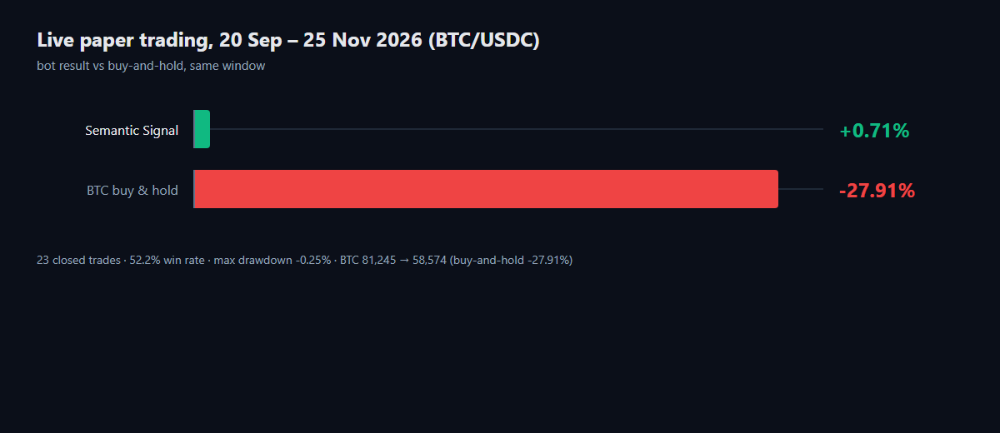

# Semantic Signal — торговый агент на LLM, который читает рынок как текст и помнит свои закрытые сделки

[](https://www.python.org)
[](../../tests)
[](../../LICENSE.md)
[](https://github.com/qrak/LLM_trader/actions/workflows/tests.yml)
[](https://github.com/qrak/LLM_trader/actions/workflows/codeql.yml)

**Читать на:** [English](../../README.md) · [Polski](README.pl.md) · [中文](README.zh.md) · [日本語](README.ja.md) · [한국어](README.ko.md) · [Español](README.es.md) · [Deutsch](README.de.md) · [Português](README.pt.md) · **Русский**


**Semantic Signal** — экспериментальный торговый агент. На каждой закрытой свече он отправляет рыночные индикаторы, новости и память о закрытых сделках текстовой модели, а затем проверяет ответ детерминированными правилами риска. Графики нужны для панели и Discord, а не для входа модели. Публичные результаты ниже смоделированы; необязательная пересылка ордеров требует отдельного исполнителя.

[Живая панель](https://semanticsignal.qrak.org) · [Журнал сделок](https://qrak.org/results/) · [Как работает цикл](https://qrak.org/story/) · [Документация](../README.md)

## Результаты

*Примечание: этот локализованный текст заморожен. Актуальные официальные цифры — в [английском README](../../README.md).*

**Окно:** 2026-09-20 → 2026-11-25 (67 дней), BTC/USDC, свечи по 4h, 10 000 USDC смоделированного капитала.
**Источник:** собственный журнал бота, замороженный в [`results/2026-11-25/`](../../results/2026-11-25); `python scripts/results_report.py --data-dir results/2026-11-25` печатает заново каждую цифру ниже.

| метрика | бот | купить и держать |
|---|---|---|
| Доходность (брутто) | **+0.71%** (+$70.78) | **-27.91%** |
| Закрытые сделки | 23 (23 учтены) + 8 исключены (исполнение не подтверждено или не состоялось) | — |
| Доля прибыльных | 52.2% (12П / 11У) | — |
| Профит-фактор | 1.91 | — |
| Sharpe / Sortino (на сделку, без аннуализации) | 0.31 / 0.74 | — |
| Максимальная просадка | -0.25% | — |
| Лучшая / худшая сделка | +6.29% / -2.67% | — |
| Стоимость инференса | $7.64 (11.8M входящих / 5.2M исходящих токенов) | — |
| Чистый результат после инференса | +$63.14 | — |
| Анализы | 224 цикла, медиана 259 с, $0.0093 за прогон | — |



За эти 67 дней бот дал +0.71%, тогда как базовый актив упал на 27.91%. Это
28.6 процентного пункта на 23 учтённых сделках — не доказательство преимущества.
Доходность не вычитает торговые комиссии. Статистика исключает восемь пар, чьё
исполнение не удалось сверить с реальным рынком или чей вход так и не состоялся. Цифры выше взяты из этого
замороженного среза, а не из живого журнала, поэтому они не меняются с каждым циклом бота.
Методика, таблица по сделкам и команда воспроизведения:
`python scripts/results_report.py --data-dir results/2026-11-25`.

## Быстрый старт

```bash
git clone https://github.com/qrak/LLM_trader.git && cd LLM_trader
python -m venv .venv && source .venv/bin/activate  # Windows: .venv\Scripts\Activate.ps1
pip install --no-compile -r requirements.txt -c constraints.txt
cp config/config.ini.example config/config.ini  # шаблон из репозитория; при необходимости смените провайдера
cp keys.env.example keys.env  # или экспортируйте ключ провайдера; `provider = custom` на локальном сервере ключ не требует
python start.py               # панель на http://localhost:8000
```

Только Python **3.13**, ~3 ГБ диска, один ключ API (или любой локальный сервер, совместимый с OpenAI или Anthropic). Платформенные лаунчеры,
особенности Windows и полная таблица секретов: [docs/SETUP.md](../SETUP.md).

## Узнать больше

- [Возможности и реализация](../FEATURES.md) · [Настройка](../CONFIGURATION.md) · [Локальная панель настроек](../SETTINGS_PANEL.md)
- [Участие в разработке](../../CONTRIBUTING.md) · [Инструкции для агентов](../../AGENTS.md) · [Безопасность](../../SECURITY.md) · [Changelog](../../CHANGELOG.md)
```bash
python -m pytest tests -q  # 3,043 теста, ~65 с
```

## Лицензия

[MIT](../../LICENSE.md). Экспериментальное ПО, не финансовая рекомендация; смоделированные результаты не доказывают прибыльность.
